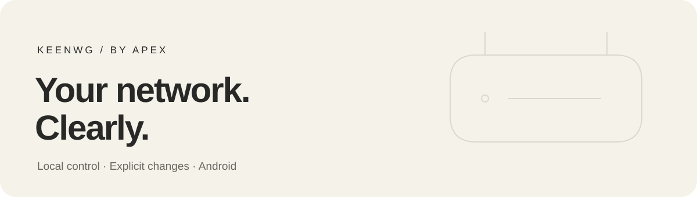
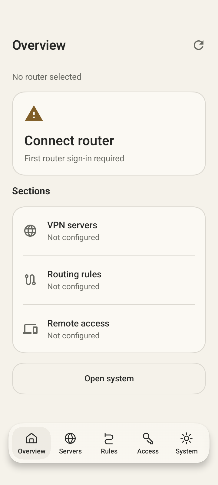
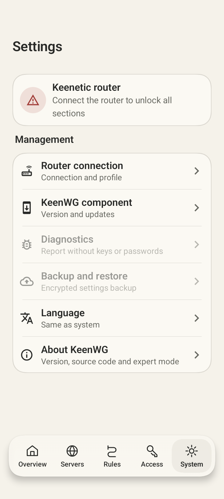
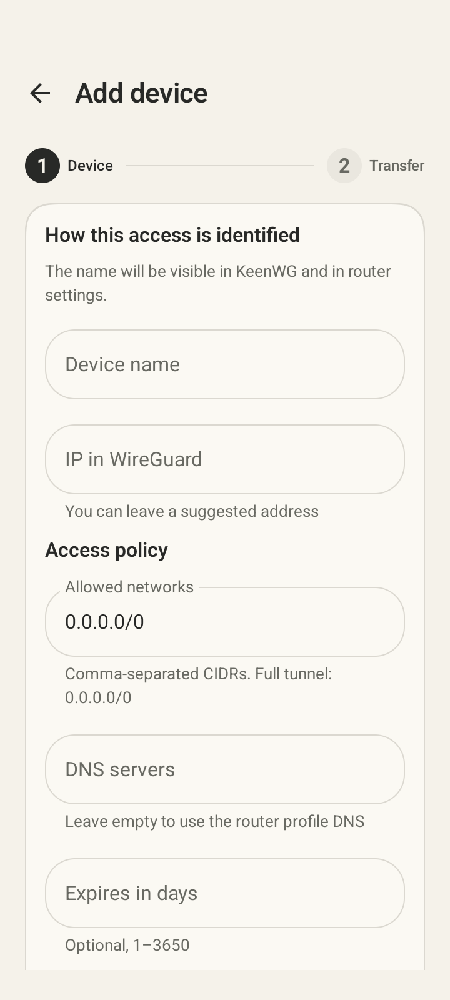

# KeenWG



[English](README.md) · [Русский](README.ru.md) · **Deutsch**

[APK herunterladen](https://github.com/apex-intellect/keenwg/releases/latest) · [Kompatibilität](docs/COMPATIBILITY.md) · [Sicherheit](SECURITY.md)

KeenWG ist eine lokale Android-Verwaltungsoberfläche für **Keenetic- und Netcraze-Router**. WireGuard-Zugänge, XKeen/VLESS-Verbindungen, Routing und Wartung bleiben unter Ihrer Kontrolle — ohne Cloud-Konto oder externen Verwaltungsserver.

Entwickelt von [Apex Intellect](https://apex-intellect.ru/) und Mitwirkenden. Verantwortlicher Entwickler: [@th-notorious](https://github.com/th-notorious). Dieses Repository enthält den offiziellen Quellcode und die Veröffentlichungen.

## Native Oberfläche

<p align="center">
  <picture><source media="(prefers-color-scheme: dark)" srcset="docs/media/overview-dark.png"></picture>
  <picture><source media="(prefers-color-scheme: dark)" srcset="docs/media/system-dark.png"></picture>
  <picture><source media="(prefers-color-scheme: dark)" srcset="docs/media/add-dark.png"></picture>
</p>

Aufnahmen des Android-Emulators ohne gekoppelten Router. Keine privaten Schlüssel oder erfundenen Verkehrsdaten.

## Funktionen

| Bereich | Möglichkeiten |
| :--- | :--- |
| Übersicht | Routerzustand und verfügbare Funktionen prüfen; Profile wechseln |
| Verbindungen | VLESS-Links und Abonnements importieren, Metadaten prüfen, manuell aktualisieren und Server auswählen; XKeen bei unterstütztem Companion steuern |
| Regeln | Domains, GeoSite, IP/CIDR-Ausnahmen und feste DHCP-Adressen; Änderungsvorschau und Routendiagnose |
| Zugänge | WireGuard-Zugänge erstellen, aktivieren, Schlüssel erneuern und widerrufen; optionaler lokaler Verlauf |
| System | Geräte koppeln, Berechtigungen verwalten, Companion aktualisieren, bereinigte Diagnosen und verschlüsselte Sicherungen |

Die Oberfläche verwendet Elfenbein- und Graphittöne, helle und dunkle Themen, weiche Ecken und eine schwebende halbtransparente Navigation. Daten stammen aus dem tatsächlichen Routerzustand, nicht aus Demo-Werten.

Die Navigation liegt über dem scrollenden Inhalt und zeichnet ab Android 12 den Hintergrund weich. Android 8–11 verwendet eine getönte Oberfläche ohne Unschärfe. Schaltflächen haben einheitliche Rundungen und kompakte Abmessungen mit ausreichend großen Berührungsflächen.

> [!IMPORTANT]
> Das Öffnen der App aktualisiert keine Abonnements und ändert weder Land noch Routingregeln. Netzwerkänderungen werden ausdrücklich ausgelöst und anhand der Geräteberechtigungen geprüft.

## Schnellstart

1. Die signierte APK aus der [aktuellen Veröffentlichung](https://github.com/apex-intellect/keenwg/releases/latest) installieren.
2. Auf dem Router muss **Entware** verfügbar sein. Bei Bedarf verweist die App auf die [XKeen-Anleitung](https://github.com/Corvus-Malus/XKeen). Sie formatiert keine Datenträger. XKeen selbst ist optional.
3. **System → Router connection** öffnen.
4. Entware-Zugangsdaten einmal eingeben. Typische Werte sind Benutzer `root`, SSH-Port `222` und Adresse `192.168.1.1`; sie sind anpassbar.
5. Der Assistent prüft den Router, installiert bei Bedarf `ndmq` über Entware, erhält vorhandene Dienste und richtet einen eigenen widerrufbaren Gerätezugang ein.
6. Vorhandene WireGuard-Zugänge und Heimnetzgeräte stehen nach der Kopplung bereit. Ein vorhandener Standard-Collector wird automatisch erkannt.

Details und Wiederherstellung: [Companion-Einrichtung](docs/COMPANION-SETUP.md).

<details>
<summary>Bestehende Installation aktualisieren</summary>

Companion-Versionen vor 2.2.0 benötigen für die Umstellung auf signierte Updates noch einmal das Routerpasswort. Danach erfolgen Updates über den gesicherten Kanal mit einer geprüften Apex-Intellect-Signatur.

Stimmt das installierte Programm bereits überein, wird nur das Telefon gekoppelt. Andernfalls erfolgt eine geprüfte transaktionale Aktualisierung unter Erhalt der Routeridentität, vertrauenswürdiger Geräte, Abonnements, Regeln und aktiver Route.

Zuerst die Android-App aktualisieren. Den Routerdienst anschließend bei Bedarf separat unter **About → Router component** aktualisieren. Ein neuer APK-Release ersetzt den laufenden Routerdienst nicht automatisch.

</details>

## Kompatibilität

- Android 8.0 oder neuer; App-Oberfläche auf Englisch und Russisch.
- Router mit ARM64 und Entware.
- Physisch geprüfte Basis: Netcraze Hopper SE NC-3812, KeeneticOS 5.01.C.1.0-0, XKeen 2.0 und Xray 26.3.27.
- Andere ARM64-Modelle gelten bis zur Prüfung als experimentell.
- Nicht unterstützt: MIPS/MIPSel, öffentlicher/WAN-Listener für Companion und automatischer Länderwechsel.

Die Angaben beschreiben eine geprüfte Basis, keine Zertifizierung beliebiger neuer Versionen. [Kompatibilitätsmatrix](docs/COMPATIBILITY.md).

## Architektur und Sicherheit

Die App kommuniziert mit Companion über HTTPS, mit exakt geprüftem Zertifikat und einem separaten widerrufbaren Token pro Gerät. Profilgeheimnisse werden mit Android Keystore geschützt. Berechtigungen sind `viewer`, `operator` und `owner`; Sicherung und Wiederherstellung sind dem Eigentümer vorbehalten.

Companion verwaltet Routeroperationen, Änderungen, Diagnosen und Updates. XKeen/Xray sind optional. Der optionale Collector speichert WireGuard-Verlauf lokal und wird ausschließlich über Companion angesprochen. Seine Adresse und sein Token gehören nicht auf das Telefon. Legacy-RCI bleibt für noch nicht gekoppelte Profile verfügbar; der alte eigenständige HTTP-Verwaltungsdienst wurde entfernt.

> [!WARNING]
> Keine privaten Schlüssel, Abonnement-URLs, VLESS-URIs, Passwörter, Kopplungsgeheimnisse, Gerätetoken, Sicherungen, Hostnamen, MAC-Adressen oder vollständigen öffentlichen IP-Adressen veröffentlichen. Für Fehlerberichte den bereinigten Diagnoseexport verwenden.

[Sicherheitsrichtlinie](SECURITY.md) · [Sicherheitsmodell](docs/SECURITY-MODEL.md) · [Datenschutz](PRIVACY.md) · [APK-Signatur](docs/SIGNING.md)

## Entwicklung

<details>
<summary>Build-Voraussetzungen und Prüfungen</summary>

JDK 17, Android SDK 35 und Go 1.26.11; Gradle Wrapper 8.12 liegt bei.

```bash
./gradlew :app:testDebugUnitTest :app:lintDebug :app:assembleDebug
(cd xkeen-control && go test ./... && go vet ./...)
(cd collector && go test ./... && go vet ./...)
```

Unter Windows `gradlew.bat` verwenden und `ANDROID_HOME` auf das SDK setzen. Release-Prüfungen umfassen Tests, Race- und Schwachstellenprüfungen, Paket-Lifecycle, Sprachressourcen, Signaturen und SBOM.

[Mitwirken](CONTRIBUTING.md) · [Designsystem](docs/DESIGN-SYSTEM.md)

</details>

Diese Übersetzung betrifft die Dokumentation, nicht zusätzliche App-Sprachen. Die englische README ist maßgeblich.

## Lizenz und offizielle Builds

[Apache License 2.0](LICENSE). Unveränderte APK-Kopien bleiben durch das veröffentlichte Signaturzertifikat überprüfbar. Veränderte Builds benötigen einen eigenen Namen, ein eigenes Symbol, eine eigene Application-ID und einen eigenen Signaturschlüssel. [Markenrichtlinien](TRADEMARKS.md).

WireGuard, Keenetic, Netcraze, XKeen und Xray sind Marken ihrer jeweiligen Eigentümer; Kompatibilität bedeutet keine Unterstützung des Projekts durch diese.
