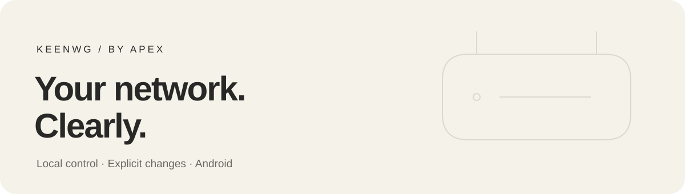
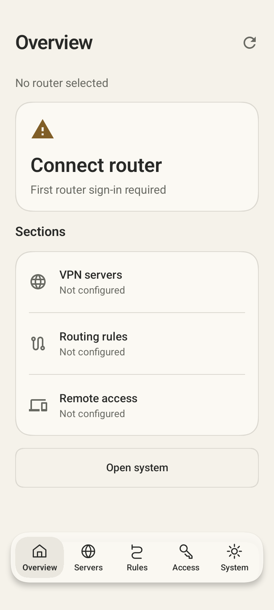
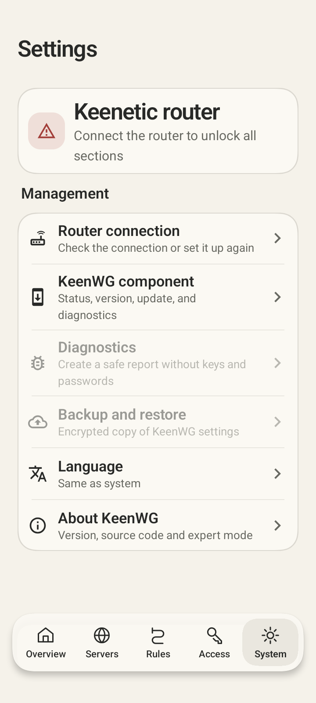
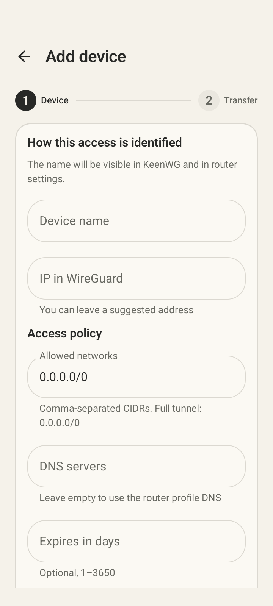

<p align="center">
  <picture>
    <source media="(prefers-color-scheme: dark)" srcset="docs/media/hero-dark.svg">
    
  </picture>
</p>

<p align="center">
  <a href="https://github.com/apex-intellect/keenwg/releases/latest"></a>
  <a href="https://github.com/apex-intellect/keenwg/actions/workflows/verify.yml"></a>
  <a href="LICENSE"></a>
  
</p>

<p align="center">
  <strong>English</strong> · <a href="README.ru.md">Русский</a> · <a href="README.de.md">Deutsch</a>
</p>
<p align="center">
  <a href="https://github.com/apex-intellect/keenwg/releases/latest"><strong>Download APK</strong></a> ·
  <a href="#quick-start">Quick start</a> ·
  <a href="docs/COMPATIBILITY.md">Compatibility</a> ·
  <a href="SECURITY.md">Security</a>
</p>

KeenWG is a local Android control panel for **Keenetic and Netcraze** routers. Manage WireGuard access, XKeen/VLESS connections, routing rules and router maintenance in one place — without a cloud account or an external management server.

Built by [Apex Intellect](https://apex-intellect.ru/) and contributors. Lead developer: [@th-notorious](https://github.com/th-notorious). This repository is the official source for code, releases and issues.

## Native screens

<p align="center">
  <picture><source media="(prefers-color-scheme: dark)" srcset="docs/media/overview-dark.png"></picture>
  <picture><source media="(prefers-color-scheme: dark)" srcset="docs/media/system-dark.png"></picture>
  <picture><source media="(prefers-color-scheme: dark)" srcset="docs/media/add-dark.png"></picture>
</p>

Android emulator captures in the unpaired state. No real router, private keys or fabricated traffic are shown.

## A calmer way to manage your network

Ivory and graphite, light and dark themes, continuous corners and a floating translucent navigation bar. The native Compose interface uses shared design tokens and components across real screens; it does not invent traffic, devices or connection status.

The navigation floats above scrolling content with live background blur on Android 12+, plus subtle edge refraction on Android 13+. Android 8–11 uses a tinted fallback. Buttons share rounded corners and compact, accessible sizing. The Route K icon and company wordmark match the ivory/graphite palette.

| Area | What you can do |
| :--- | :--- |
| **Overview** | Check router health and available capabilities; switch router profiles. |
| **Connections** | Import a VLESS link or subscription, inspect provider metadata, refresh manually and select a node. Control XKeen when supported by the paired Companion. |
| **Rules** | Manage domains, GeoSite, IP/CIDR exclusions and static DHCP addresses. Preview changes and explain routing decisions. |
| **Access** | Create, enable, rotate and revoke WireGuard access. View optional local history. |
| **System** | Pair devices, manage permissions, update Companion, export sanitized diagnostics and restore encrypted backups. |

Subscription titles, expiry and usage are read from compatible [provider metadata](https://github.com/HappDev/happ_su/blob/main/dev-docs/app-management.md). A missing value stays unknown; it is not synthesized.

> [!IMPORTANT]
> Opening the app does not refresh subscriptions, change countries or apply routing presets. Network mutations require an explicit action. Capability and permission checks remain in place.

## Quick start

1. Download the signed APK from the [latest release](https://github.com/apex-intellect/keenwg/releases/latest).
2. Ensure **Entware** is available. If not, KeenWG points to the [XKeen community instructions](https://github.com/Corvus-Malus/XKeen). The app does not format storage. XKeen itself is optional; only its related features depend on it.
3. Open **System → Router connection**.
4. Enter your Entware credentials once. A typical setup uses `root`, SSH port `222` and router address `192.168.1.1`; all can be changed.
5. The wizard checks the router, installs `ndmq` through Entware if needed, preserves existing XKeen/Xray/ASC/WireGuard services and provisions a separate revocable device credential.
6. Existing WireGuard peers and home devices are available after pairing. If the standard Collector is installed, history is discovered automatically.

See [Companion setup and recovery](docs/COMPANION-SETUP.md) for prerequisites and troubleshooting.

<details>
<summary>Upgrading an existing installation</summary>

Companion versions before 2.2.0 require the router password once more to migrate to signed updates. Later updates use the paired secure channel and a signature verified against the trusted Apex Intellect key.

When the installed binary already matches, setup only pairs the phone. A different binary uses a verified transactional update, preserving router identity, trusted devices, the active route, subscriptions and user rules.

Update the Android app first. Update the router component separately from **About → Router component** when needed. Publishing an APK does not automatically replace a running router service.

</details>

## Compatibility

| Component | Requirement / verified baseline |
| :--- | :--- |
| Phone | Android 8.0+; English and Russian app UI |
| Router | ARM64 with Entware |
| Physically verified hardware | Netcraze Hopper SE, NC-3812 |
| Verified software baseline | KeeneticOS 5.01.C.1.0-0, XKeen 2.0, Xray 26.3.27 |
| Other ARM64 hardware | Experimental until physically validated |
| Not supported | MIPS/MIPSel, public/WAN Companion listeners, automatic country switching |

This is a **tested baseline**, not a claim that every newer router or core version is certified. See the [compatibility matrix](docs/COMPATIBILITY.md).

## Local by design

The app talks to Companion over HTTPS with **exact certificate pinning** and a **separate revocable token per device**. Router profile secrets are stored using Android Keystore. Trusted devices have `viewer`, `operator` or `owner` permissions; encrypted backup/restore is owner-only.

| Module | Responsibility |
| :--- | :--- |
| Android app | User interface, explicit actions, local profiles and protected credentials |
| Companion | Authorized router operations, routing transactions, updates and diagnostics |
| XKeen / Xray | Optional proxy connections and routing |
| Collector | Optional router-local WireGuard history; accessed only through Companion |
| Legacy RCI | Local fallback for profiles that have not paired with Companion |

Collector is optional and does not determine current connectivity or peer control. The phone never needs its address or token. The standalone legacy HTTP management service is no longer part of the 2.x architecture.

## Build and contribute

<details>
<summary>Android, Go and release checks</summary>

Requirements: **JDK 17**, **Android SDK 35**, **Go 1.26.11**. The repository includes **Gradle Wrapper 8.12**.

```bash
./gradlew :app:testDebugUnitTest :app:lintDebug :app:assembleDebug
(cd xkeen-control && go test ./... && go vet ./...)
(cd collector && go test ./... && go vet ./...)
```

On Windows, use `gradlew.bat`. Set `ANDROID_HOME` to the SDK location.

Release verification includes race checks, vulnerability scanning, shell lifecycle tests, locale/UI resource checks, APK signing checks and SBOM generation. The tag must match the app version, and missing signing credentials fail the release.

Shared UI primitives live in `ui/theme` and `ui/components`; see [the design-system guide](docs/DESIGN-SYSTEM.md). Contribution instructions: [CONTRIBUTING.md](CONTRIBUTING.md).

</details>

Translations of this README are documentation translations; they do not imply additional app UI languages. English is the canonical README.

## Security and privacy

> [!WARNING]
> Never attach private keys, subscription URLs, VLESS URIs, router passwords, pairing secrets, device tokens, backups, hostnames, MAC addresses or complete public IPs to an issue. Use the app's sanitized diagnostic export.

[Security policy](SECURITY.md) · [Security model](docs/SECURITY-MODEL.md) · [Privacy](PRIVACY.md) · [APK signing](docs/SIGNING.md)

Unmodified APK mirrors remain verifiable: the app checks its signing certificate against the published Apex Intellect certificate. Modified builds must use a distinct name, icon, application ID and signing key. See [branding and distribution](TRADEMARKS.md).

## License

[Apache License 2.0](LICENSE). WireGuard, Keenetic, Netcraze, XKeen and Xray are trademarks of their respective owners; compatibility does not imply endorsement.

---

<p align="center"><sub>Local control. Explicit changes. Your network.</sub></p>
